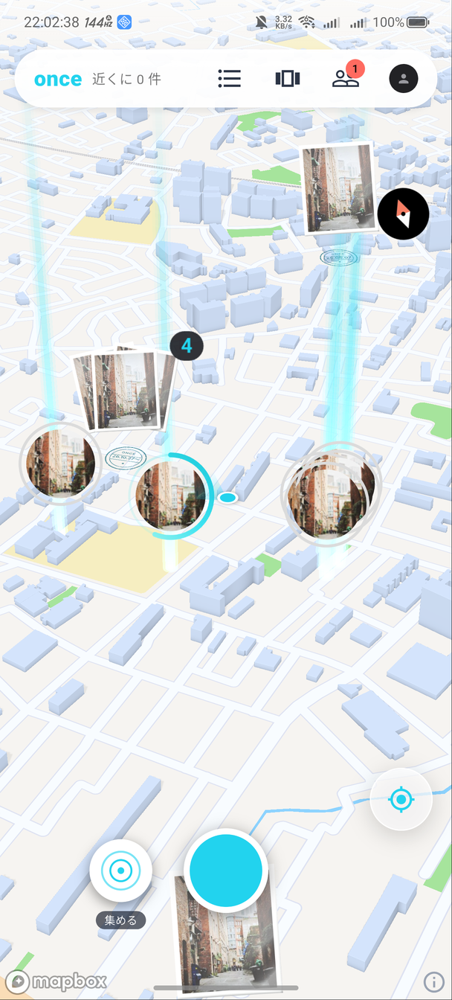

# once — あの日の、ここ。

写真を撮った場所に残す、位置情報の思い出アプリです。

> このリポジトリは **アプリを試していただくための配布用** です。ソースコードは含まれていません。

  

## どんなアプリか

- **撮った場所に残る**: 写真を撮ると、そのあと 2〜6 秒の音のない動き（ライブフォトのようなもの）も一緒に、撮った地点の地図に残ります。
- **はじめの 24 時間は「ストーリー」**: 投稿は友達の地図にアイコンの輪で出て、残り時間が輪の弧で減っていきます。輪の上には光の柱が立ち、地球まで引いても見えます。
- **24 時間たつと「思い出」**: ストーリーは消えずに、その場所の思い出（プリントと消印）になります。
- **その場所に行くとひらく**: 友達の思い出は、その場所の近く（1km 以内）に行くと中身が見られます。
- **数字を競わない**: いいねの数・フォロワー数は誰にも表示しません。コメントや DM もありません。
- **場所を守る**: はじめは非公開アカウントで、投稿は友達だけに見えます。よく来る場所からの公開投稿は、知らない人には「だいたいの場所」で表示します。写真の位置のメタデータは取り除いてからアップロードします。

## インストール（Android）

1. 右の **[Releases](../../releases)** から最新の `once-*.apk` をダウンロードします。
2. ダウンロードした APK を開きます。「提供元不明のアプリ」の確認が出たら、ブラウザ（またはファイルアプリ）からのインストールを許可してください。
3. インストール後、once を開いて **メールアドレスで新規登録**（確認のメールが届いたらリンクを開いてください）、または **Google でログイン** してください。
4. 位置情報とカメラの許可を求められたら許可してください（地図と撮影に必要です）。

- 対応: Android 7.0 以上（arm64 の端末。ここ数年のスマホはほぼすべて）
- iPhone 版は配布していません。

## 試し方のヒント

- once は **自分の周りの投稿だけ** が地図に出ます。はじめは地図が空なので、まず下の丸いボタンで 1 本撮ってみてください。自分の投稿は右上のプロフィールから見られます。
- 友達を追加すると、友達のストーリーが輪と光の柱で地図に出ます（プロフィールの「友達」から、QR コード・招待リンク・ユーザー名で追加できます）。
- 地図は 2 本指で回したり傾けたり、地球が見えるまで引いたりできます。

## データについて

- 投稿・アカウントは本番の環境に保存されます。試したあとは、プロフィール → 設定 → **「アカウントを削除」** で削除できます。

## 作り

Flutter（iOS / Android）、Supabase（認証・データベース・ストレージ・Edge Functions）、Mapbox（3D の地図）。
